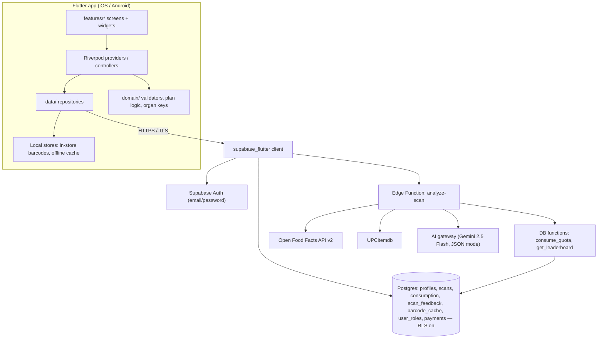
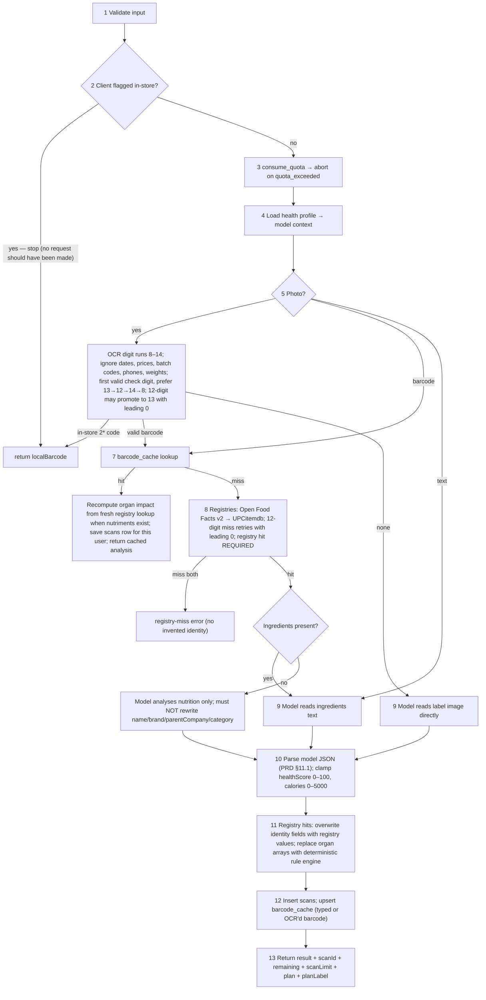

# RAPscanz — Architecture (Flutter client + Supabase backend)

**Source of truth:** PRD.md (§5 principles, §7 functional requirements, §8 plans, §10 analysis pipeline, §11 data contracts, §13 non-functional).
**Companion docs:** design.md (UX/copy), CLAUDE.md (execution plan).

The referenced web repo is not present, so this document fully specifies the backend to be **recreated** on Supabase, plus the Flutter client.

---

## 1. System overview



**Non-negotiables (PRD §5, §10, §13):**
- The phone **never** calls the model or food registries directly and **never** holds the AI key.
- Quota is enforced on the server only; the client displays `remaining`/`scanLimit`/`planLabel` and never invents resets.
- Product identity is never invented from a barcode prefix; registry miss = clear error + route to photo/text.
- Health profile fields never leave the profile context; the leaderboard response excludes them.

## 2. Flutter client

### 2.1 Tech choices

| Concern | Choice |
| --- | --- |
| Language / SDK | Dart ^3.13.5, Flutter stable |
| State management | `flutter_riverpod` (code-gen free: `Notifier`/`AsyncNotifier` + `Provider`) |
| Routing | `go_router` with a redirect-based auth gate |
| Backend | `supabase_flutter` (auth + PostgREST + edge functions) |
| Session persistence | supabase_flutter session + `flutter_secure_storage` for the refresh token |
| Barcode scanning | `mobile_scanner` (EAN-8, EAN-13, UPC-A, ITF-14) |
| Photos | `image_picker` + `flutter_image_compress` (target well under 5 MB) |
| Local inventory | `shared_preferences` (JSON map under key `rapscanz.localBarcodes.v1`) |
| Offline cache | `shared_preferences` (or `hive`) for history list + profile snapshots |
| DTOs | `freezed` + `json_serializable` |
| Fonts | Bundled OFL Bricolage Grotesque + Plus Jakarta Sans |

### 2.2 Module layout (PRD §11.3)

```
lib/
  main.dart                  // ProviderScope, Supabase.init, runApp
  app/
    router.dart              // go_router, auth-gate redirect, bottom-nav shell
    theme.dart               // tokens from design.md §2
    session.dart             // auth state provider, session gate
  domain/
    scan_result.dart         // ScanResult, Caution, ConsumptionTip, RiskProfile, BodyMarker
    plan.dart                // Plan enum + effective-plan + isProMax logic
    rating.dart              // good|okay|caution|avoid + labels/colors
    organs.dart              // 13 allowed organ keys
    barcode.dart             // digit strip, length check, GS1 check digit, in-store 2* detector
    dietary.dart             // veg|non-veg|vegan|unknown + badge labels
  data/
    supabase_client.dart     // client provider, config (URL/anon key via --dart-define)
    dto/                     // freezed DTOs matching PRD §11.1 + table rows
    scan_api.dart            // analyze-scan edge function calls
    profile_repository.dart
    history_repository.dart
    weekly_repository.dart    // consumption log
    leaderboard_repository.dart
    feedback_repository.dart
    local_barcodes_store.dart
    cache_store.dart
  features/
    auth/                    // sign-in/sign-up toggle screen + controller
    home/                    // marketing home, pricing cards, how-it-works
    scan/
      scan_screen.dart       // 3 modes + plan chip + primary button
      widgets/               // scanner overlay, laser animation, quota chip
      result/                // 12 ordered result blocks
      local/                 // in-store inventory dialog + saved card
    history/                 // list + detail (/history/:id)
    weekly/                  // 7-day bars + entries
    leaderboard/
    profile/                 // username + health info + BMI + sign out
    plans/                   // plans sheet (display only, no checkout)
    content/                 // trust & privacy, healthy-snacks guide
  l10n/ (v1: English strings class mirroring design.md §10 copy deck)
test/
  domain/                    // check digit, in-store detector, plan logic, clamps
  widget/                    // scan flow, gating visibility
```

### 2.3 Layering rules

- **UI → Riverpod controller → repository → supabase client.** Widgets never call Supabase directly.
- **Domain is pure Dart** (no Flutter imports): validators, plan math, organ keys, score-band mapping. All unit-tested.
- DTOs mirror PRD §11.1 exactly (snake_case on the wire, camelCase in Dart via `json_serializable` field renames).
- Repositories return domain objects or typed failures (`QuotaExceeded`, `RateLimited`, `AiUnavailable`, `RegistryMiss`, `InvalidBarcode`, `NetworkDown`) which map to the verbatim copy in design.md §10.

### 2.4 Key client decisions

1. **Pre-flight barcode checks on device** (PRD §7.3, §7.5, §15):
   - Strip non-digits as the user types.
   - In-store detector: `^2\d{7,13}$` → local inventory flow, **no server call, no credit**.
   - GS1 check-digit validation for lengths 8/12/13/14 → invalid shows the verbatim error, **no server call, no credit**.
   - A 12-digit UPC failing validation is still sent; the server retries it as EAN-13 with a leading `0`.
2. **Plan gating** (PRD §8): `ProMaxVisible = (plan == pro_max) || isUnlimited || (plan == unlimited)`; `plan_expires_at` in the past ⇒ effective `free`. Client hides gated sections even if a stale cached payload contains them; server should also omit gated fields per caller plan.
3. **Clamping on display:** `healthScore` → 0–100, `caloriesKcal` → 0–5000, even for dirty old rows (PRD §15).
4. **Session:** `SupabaseAuth` stream drives the router redirect; expired refresh token → sign-in. Sign-out clears session → Home (PRD §7.1).
5. **Offline:** history list + profile render from cache, refresh when online; scanning always requires network; local inventory works offline.
6. **Weekly window:** computed with device-local calendar days (local midnight), last 7 days including today (PRD §7.7, §15).
7. **Photos:** compress before upload; reject > 5 MB on device; photos are **not** persisted to the scan row (only text/barcode in `input_text`) — no photo archive in v1 (PRD §13).
8. **Feedback:** one row per (user, scan); re-save = upsert (PRD §7.4.12).
9. **Username:** validate format client-side; uniqueness enforced server-side case-insensitively (unique index on `lower(username)`).

## 3. Backend (Supabase, to recreate)

### 3.1 Schema (PRD §11.2)

```sql
-- profiles: id = auth.users.id
create table public.profiles (
  id uuid primary key references auth.users(id) on delete cascade,
  email text,
  username text,
  gender text default '' check (gender in ('', 'female', 'male', 'non_binary', 'other')),
  age int check (age between 1 and 129),
  weight_kg numeric check (weight_kg > 0 and weight_kg < 500),
  height_cm numeric check (height_cm > 0 and height_cm < 300),
  illnesses text default '' check (char_length(illnesses) <= 500),
  allergies text default '' check (char_length(allergies) <= 500),
  scan_count int not null default 0,
  plan text not null default 'free' check (plan in ('free','pro','pro_plus','pro_max')),
  plan_expires_at timestamptz,
  is_subscribed boolean not null default false,
  subscription_expires_at timestamptz,
  created_at timestamptz not null default now()
);
create unique index profiles_username_lower on public.profiles (lower(username)) where username is not null;

create table public.scans (
  id uuid primary key default gen_random_uuid(),
  user_id uuid not null references public.profiles(id) on delete cascade,
  product_name text,
  scan_type text not null check (scan_type in ('ingredients','barcode')),
  rating text check (rating in ('good','okay','caution','avoid')),
  health_score int,
  calories_kcal int,
  summary text,
  input_text text,            -- pasted ingredients or barcode; NEVER photos
  result jsonb not null,      -- full PRD §11.1 object
  created_at timestamptz not null default now()
);

create table public.consumption (
  id uuid primary key default gen_random_uuid(),
  user_id uuid not null references public.profiles(id) on delete cascade,
  scan_id uuid not null references public.scans(id) on delete cascade,
  product_name text,
  calories_kcal int,
  consumed_at timestamptz not null default now()
);

create table public.scan_feedback (
  id uuid primary key default gen_random_uuid(),
  user_id uuid not null references public.profiles(id) on delete cascade,
  scan_id uuid not null references public.scans(id) on delete cascade,
  rating int not null check (rating between 1 and 5),
  buy_again text not null check (buy_again in ('yes','maybe','no')),
  comment text check (char_length(comment) <= 1000),
  created_at timestamptz not null default now(),
  unique (user_id, scan_id)
);

create table public.barcode_cache (
  barcode text primary key,
  result jsonb not null,      -- shared analysis; identity + rule-based organs
  created_at timestamptz not null default now(),
  updated_at timestamptz not null default now()
);

create table public.user_roles (
  user_id uuid references public.profiles(id) on delete cascade,
  role text not null check (role in ('admin','founder','collaborator','user')),
  primary key (user_id, role)
);

create table public.payments (   -- server-only writes (Razorpay, INR paise)
  id uuid primary key default gen_random_uuid(),
  user_id uuid not null references public.profiles(id) on delete cascade,
  order_id text, payment_id text, amount_paise int, status text,
  created_at timestamptz not null default now()
);
```

**RLS (all tables `enable row level security`):**
- `profiles`, `scans`, `consumption`, `scan_feedback`: owner-only select/insert/update/delete (`auth.uid() = user_id` / `id`).
- Plan/quota columns (`plan`, `plan_expires_at`, `scan_count`, `is_subscribed`, `subscription_expires_at`) are **not client-writable** — enforce via a restrictive update policy with column grants (grant update only on profile/health columns) or a trigger that rejects changes to those columns from non-service roles.
- `barcode_cache`: no direct client read (clients go through the scan API — never query the cache to skip quota).
- `payments`: user may select own rows; writes service-role only.
- `user_roles`: user may select own roles; writes service-role only.

### 3.2 Database functions

```sql
-- Leaderboard (PRD §7.8): usernames with >= 3 scored scans, avg desc, count desc, cap 50.
create or replace function public.get_leaderboard()
returns table(username text, avg_score numeric, scan_count bigint)
language sql security definer stable as $$
  select p.username,
         round(avg(s.health_score)) as avg_score,
         count(*) as scan_count
  from public.scans s
  join public.profiles p on p.id = s.user_id
  where p.username is not null and s.health_score is not null
  group by p.username
  having count(*) >= 3
  order by avg(s.health_score) desc, count(*) desc
  limit 50;
$$;
-- NOTE: response exposes username + aggregate scores only — never health profile fields.

-- Quota consumption (PRD §7.3, §8): called by the edge function with service role.
-- Effective plan: paid plan with plan_expires_at < now() degrades to 'free'.
-- Roles admin/founder/collaborator: unlimited (limit sentinel 999_999), recorded as pro_max.
create or replace function public.consume_quota(p_user uuid)
returns jsonb language plpgsql security definer as $$
  -- 1. load profile + roles; resolve effective plan, limit, label, isUnlimited
  -- 2. if not unlimited and scan_count >= limit: return { ok:false, error:'quota_exceeded', ... }
  -- 3. increment scan_count (lifetime counter; monthly reset is an open server decision, PRD §16)
  -- 4. return { ok:true, remaining, scanLimit, plan, planLabel, isUnlimited }
$$;
```

Plan limits: `free 30 · pro 60 · pro_plus 120 · pro_max 240 · unlimited 999999`.

### 3.3 Edge function: `analyze-scan` (PRD §10)

Request:

```
Authorization: Bearer <user JWT>
{
  "scanType": "ingredients" | "barcode",
  "text"?: string,            // <= 10_000 chars
  "barcode"?: string,         // 1–32 chars, [A-Za-z0-9-], checksum-valid
  "imageDataUrl"?: string     // <= ~7.5 MB encoded (client rejects > 5 MB files)
}
```

Pipeline (13 steps — implement exactly):



Rules to preserve:
- **Credit timing:** one credit consumed at step 3, *before* the model call — including cache hits. Failed validation (bad barcode, empty input) consumes nothing. Local in-store lookups consume nothing. If the model later fails, the credit is still spent and the UI shows the error with the reduced remaining count (PRD §15).
- **Registries:** OFF fields used: product name (incl. English/Hindi ingredient text), brands, brand owner, categories, quantity, nutriments, labels. UPCitemdb: title, brand, category (often no ingredients → nutrition via model with identity locked). GS1 prefix is only a country-of-issue hint (India = 890), never a brand source.
- **Model:** Gemini 2.5 Flash via the Gemini API directly (the web app used the Lovable AI gateway; the client is vendor-agnostic — the contract is the §11.1 schema + PRD rules). JSON mode / structured output. Tier-specific instructions applied server-side from the effective plan (percentage fields, formula/scientific name, consumption tip, risk profile, body map). Prefer omitting gated fields for the caller's plan in the response.
- **Category discipline:** categories stay specific (milk chocolate bar ≠ energy bar; chikki ≠ extruded snack). Never copy nutrition numbers across categories. Unclear input → productName "Unidentified product", category "Unknown", summary says the image/barcode was not clear enough.
- **Identity fields:** `productName` is the consumer product ("Dairy Milk Silk"), `brand` the line ("Dairy Milk"), `parentCompany` the owner ("Mondelez (formerly Cadbury)").
- **Health context:** built server-side from gender, age, weight, height, BMI, conditions, allergies; `personalAdvice` must mention listed allergens and conflicts with stated conditions (diabetes, hypertension, PCOS) when relevant; empty when profile is empty.
- **Dietary rules (§7.4.3):** egg = non-veg (Indian convention); mono-/diglycerides vegetarian unless clearly animal; D3 lanolin veg / lichen vegan; gelatin non-veg; L-cysteine non-veg unless microbial; rennet non-veg unless microbial/vegetable; carmine/cochineal E120 and shellac E904 non-veg. Always include `dietaryReason`.

### 3.4 Deterministic organ rule engine (PRD §7.4.2)

Server-side module (port of the web `organImpact.ts` logic, specified here since the source repo is absent):

- Input: per-100 g nutriments (sugar, saturated fat, salt, fibre, protein, micronutrients) + ingredient text (palm oil, trans fat, MSG, artificial sweeteners, caffeine, alcohol, azo colours, nitrites, probiotics, omega-3, whole grains…).
- Output: `bodyDamage[]` and `bodyBenefit[]` with `part` ∈ the 13 organ keys, `severity` ∈ low|medium|high, `reason`, optional `trigger`.
- **Deterministic:** same inputs ⇒ same organs, always. Implemented as a threshold/rule table, versioned (`organRules.v1`), unit-tested with fixture nutriments.
- Applied only when barcode nutrition data exists; otherwise the model supplies `bodyDamage`/`bodyBenefit`.
- Risk profile (`riskProfile`) is empty for clearly healthy products (healthScore ≥ 75 or rating `good`); each list 2–5 short clauses grounded in published guidance (WHO, FDA, EFSA, ICMR-NIN, AHA, NIH). Consumption-tip numbers must cite a real guideline source. Never invent diseases or limits.

### 3.5 Secrets & config

| Secret | Where | Notes |
| --- | --- | --- |
| `GEMINI_API_KEY` | Edge function env (Supabase secrets) | Gemini 2.5 Flash, JSON mode, called directly from the edge function. Never in the app bundle |
| `SUPABASE_URL`, `SUPABASE_ANON_KEY` | Flutter `--dart-define` (env placeholders until provided) | Anon key only; service-role key never ships |
| `SUPABASE_SERVICE_ROLE_KEY` | Edge function env | Quota increment, cache upsert |
| `UPCITEMDB_API_KEY` (optional) | Edge function env | Only if the keyless UPCitemdb rate limit is hit |

## 4. Data contracts

### 4.1 Scan result (PRD §11.1 — wire schema)

```json
{
  "productName": "string",
  "brand": "string?",
  "parentCompany": "string?",
  "category": "string?",
  "rating": "good | okay | caution | avoid",
  "healthScore": 0,
  "caloriesKcal": 0,
  "summary": "string",
  "advantages": ["string"],
  "disadvantages": ["string"],
  "cautions": [{ "ingredient": "string", "concern": "string", "severity": "low | medium | high",
                 "percentage": "string?", "chemicalFormula": "string?", "scientificName": "string?" }],
  "personalAdvice": "string?",
  "consumptionTip": { "safeDaily": "string", "limit": "string", "source": "string" },
  "riskProfile": { "illnesses": ["string"], "addictions": ["string"], "chronicDamage": ["string"],
                   "temporaryEffects": ["string"], "organDamage": ["string"] },
  "bodyDamage":  [{ "part": "string", "severity": "low|medium|high", "reason": "string", "trigger": "string?" }],
  "bodyBenefit": [{ "part": "string", "severity": "low|medium|high", "reason": "string", "trigger": "string?" }],
  "dietaryType": "veg | non-veg | vegan | unknown",
  "dietaryReason": "string?"
}
```

API envelope adds: `scanId`, `remaining`, `scanLimit`, `plan`, `planLabel` (+ `isUnlimited` when role-based).

### 4.2 Error envelope

```
{ "error": "quota_exceeded" | "rate_limited" | "ai_unavailable" | "ai_credits_exhausted"
           | "registry_miss" | "invalid_barcode" | "validation" | "local_barcode",
  "message": "<verbatim user copy from design.md §10>",
  "remaining"?: int, "scanLimit"?: int, "plan"?: string, "planLabel"?: string,
  "localBarcode"?: string }
```

Client maps `error` → toast/inline card; never shows raw exceptions.

## 5. Testing strategy (PRD §13–14)

| Layer | Tests |
| --- | --- |
| Domain (pure Dart) | GS1 check digit (8/12/13/14, UPC→EAN-13 promotion), in-store `2*` detector, plan/effective-plan/isProMax logic, score/calorie clamps, score-band labels, BMI math, username regex |
| Edge function | Quota consumption ordering (credit before model, none on validation failure), registry fallback OFF→UPCitemdb, UPC retry with leading 0, identity overwrite, organ rule determinism (fixtures), tier-gated field omission |
| SQL | RLS owner-only access; plan/quota columns not client-writable; `get_leaderboard()` min-3 rule, ordering, cap 50; username unique case-insensitive |
| Widget | Scan flow happy path + each error toast; gated sections hidden for Free, visible for Pro Max; locked teasers reveal nothing; history empty state; weekly bars |

## 6. Traceability to PRD acceptance criteria (§14)

| # | Criterion | Where implemented |
| --- | --- | --- |
| 1 | Sign-up → Scan, "Free · 30 of 30" | app shell + quota chip (Phase 1) |
| 2–3 | Text scan result; known EAN-13 identity + cache consistency | edge function steps 7–13 (Phase 0/2) |
| 4–5 | Bad check digit / unknown barcode: no credit, no invented brand | domain.barcode + edge steps 1, 8 |
| 6 | `2*` local inventory, no credit, survives restart | local_barcodes_store |
| 7 | Photo → barcode or image analysis; > 5 MB rejected on device | scan photo mode + edge step 5 |
| 8 | "For you" note; health fields off leaderboard | health context + `get_leaderboard` projection |
| 9 | I ate this / weekly totals / delete log only | consumption table + weekly repo |
| 10 | Leaderboard qualification rules | `get_leaderboard()` |
| 11–12 | Free sees locked teasers; Pro Max sees full detail | plan gating §2.4.2 + server field omission |
| 13 | Feedback upsert + reload | scan_feedback unique (user, scan) |
| 14 | Sign-out gates tabs; public pages reachable | router redirect |
| 15 | Screen-reader access to verdict/score/cautions | design.md §8 semantics |
